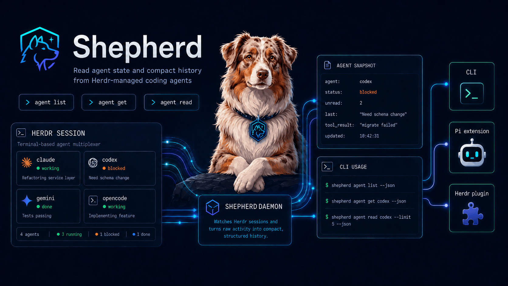

# Shepy

Documentation and agent communication are maintained in English. See [AGENTS.md](./AGENTS.md#language) for the language policy.

Shepy is a daemon-backed observability layer for coding agents running in Herdr. It provides two interfaces over the same durable agent index: pull-based CLI access to structured history, and owner-scoped Pi notifications with cached context and automatic wake.

Herdr's `herdr agent read` reads terminal streams or scrollback. Shepy instead reads agent session data so callers can retrieve work status, structured message excerpts, compact tool results, and unread outcomes without parsing terminal output. Use the official Herdr CLI or skill for agent start, prompts, waits, pane operations, and terminal control. Shepy does not type into terminals. Its optional Claude wake bridge posts a notification through the owner's private messaging socket.

Shepy currently supports session history from Claude Code, Codex, Gemini CLI, OpenCode, and Pi.

## Requirements

- Node.js >= 24.18.0
- Herdr >= 0.7.0
- Pi >= 0.80.6 when using `shepy-pi`

## Install

```bash
npm install --global shepy
shepy --help
```

### Install from source

Source builds also require pnpm >= 11.9.0.

```bash
git clone https://github.com/rayBlock/shepy.git
cd shepy
pnpm install
pnpm build
npm install --global . --ignore-scripts
shepy --help
```

## Start the daemon

Shepy agent commands and Pi notifications require the daemon. The daemon watches all running Herdr sessions reported by `herdr session list --json`, rescans them every 60 seconds, and does not index stopped Herdr sessions. Runtime files live in `~/.shepy` by default. Set `SHEPY_HOME` to use another directory.

```bash
shepy daemon start
```

## Main commands

- `shepy agent list`: returns the daemon's latest cached status and last user / assistant excerpts for the selected workspace. Check each row's `updatedAt` when freshness matters.
- `shepy agent get <target>`: performs an explicit detail lookup and returns one agent's metadata, compact history, and latest compact tool result.
- `shepy agent read <target> --limit N`: performs an explicit history read and returns the latest N user / assistant / compact `tool_result` messages.

An explicit session path or ID reported by Herdr is authoritative: cached history hints and newer sessions in the same directory cannot override it. Without a native session identity, history is empty, including when an older cached hint exists. If an ID has main transcripts in several project folders, only a unique main in the current working directory's project folder resolves the ambiguity; modification time never breaks a tie. Pi session files created after startup are retried, and previously misbound path snapshots repair on refresh without deleting the database.

Before reading history for a status event, Shepy refreshes the worker's session identity from Herdr. If a working worker settles with missing or previous-turn assistant text, Shepy re-reads once after about 500 milliseconds; text still unavailable then stays empty. Other panes' ready notices publish first, including when both completions arrive in one snapshot. If the worker starts another turn during the retry, the earlier completion is recorded without text before the newer status, never with the next turn's response. Status transitions and their events commit together, so an interrupted retry leaves the persisted worker working and a later snapshot can recover its completion. Repeated settled observations during the retry do not start another retry.

A cached Claude session with a unique main transcript remains valid when the cwd is an alias of its launch directory; the project-folder rule is needed only for multiple mains. Startup idle or done without assistant text does not notify a profile. A worker first observed already blocked does notify once, and remaining blocked across ticks or a daemon restart does not repeat that notice.

Each agent record keeps Herdr's optional live `name`, such as `reviewer`, separate from its runtime `agent` kind, such as `codex`. Human list output uses distinct `name` and `agent` columns, and JSON returns both fields. Inside a Herdr workspace, Shepy selects the current workspace automatically.

```bash
shepy agent list --json
shepy agent get reviewer --json
shepy agent read reviewer --limit 20 --json
```

From outside Herdr, pass a scope.

```bash
shepy agent list --all --json
shepy agent list --workspace wB --json
shepy agent get reviewer --workspace wB --json
shepy agent read wB:p2 --workspace wB --limit 20 --json
```

`<target>` first matches an exact pane id, terminal id, or Shepy agent id in the selected scope. It then matches an exact Herdr live name such as `reviewer`; when no live name matches, it falls back to a unique agent kind such as `codex`. Use `--session <name>` when a target is ambiguous across running Herdr sessions.

## Agent Skill

Install the Shepy CLI and start its daemon before adding the Agent Skill. Then add the Shepy instructions to supported coding agents:

```bash
npx skills add rayBlock/shepy --skill shepy -g
```

The Shepy skill reads structured agent status, compact history, and recent tool results. Use it alone for agent inspection.

Add the official Herdr skill when an agent needs to control workspaces, tabs, panes, terminal input/output, or waits:

```bash
npx skills add ogulcancelik/herdr --skill herdr -g
```

### Claude Code

Claude Code reads skills from `~/.claude/skills/<name>/SKILL.md`. Link the repository skill so it stays current with the checkout:

```bash
mkdir -p ~/.claude/skills/shepy
ln -sfn "$PWD/SKILL.md" ~/.claude/skills/shepy/SKILL.md
```

Claude Code loads skills at startup, so start a fresh session after installing or updating the link.

### Claude Code hook bridge

`shepy claude-hook --profile <profileId>` lets a Claude Code pane own a Shepy profile. If the start script sets `SHEPY_PROFILE=<profileId>` for the Claude process, use `shepy claude-hook` without a profile flag; an explicit flag takes precedence. Herdr still supplies the pane and workspace environment variables, but the settings command need not name a fixed pane. The hook claims the profile at every turn, delivers pending worker outcomes as injected context on `UserPromptSubmit` (and on `Stop`, when outcomes arrive mid-turn), and acknowledges what each prompt consumed at the next turn boundary — on the following `UserPromptSubmit`, or on `Stop` when it runs. Each re-claim presents the lease token persisted in the owner file as proof of possession: a matching token re-claims immediately with a fresh token, while a stale one is refused only while the current lease is alive and the bridge recovers by itself once it lapses (lease + grace, 5 min + 30 s at defaults) — no operator action. When a claim is refused the hook says which situation applies through a `systemMessage`: a stale persisted token (wait for the lease to lapse) is a different line from another pane owning the profile (coordinate with the owner). Register it in `.claude/settings.json` yourself — Shepy never edits that file:

```json
{"hooks":{"UserPromptSubmit":[{"hooks":[{"type":"command","command":"shepy claude-hook --profile <profileId>"}]}]}}
```

Register the `Stop` hook too — it is not optional, and the same command handles both events:

```json
{"hooks":{"Stop":[{"hooks":[{"type":"command","command":"shepy claude-hook --profile <profileId>"}]}]}}
```

For handover, register `SessionEnd` as well. It releases only the ending Claude session's recorded lease, including on clear or resume; the next prompt claims normally. A foreign or stale session cannot release the current owner:

```json
{"hooks":{"SessionEnd":[{"hooks":[{"type":"command","command":"shepy claude-hook","timeout":15}]}]}}
```

This example requires `SHEPY_PROFILE`; without it, keep `--profile <profileId>` in every hook command. To hand over before ending a session, run `shepy profile release <profileId>` from that Claude session's Bash tool. The CLI uses `HERDR_SOCKET_PATH`, `HERDR_PANE_ID` and `HERDR_WORKSPACE_ID` to resolve its live native Claude session, then reads only that session's owner file. If that identity or credential is unavailable, or belongs to a non-owner, release is refused. No lease token is accepted on the command line or printed. Release leaves subscriptions and pending notices on the profile; already leased details retain their ordinary expiry and at-least-once redelivery rules.

If a rival claim encounters a live lease, the daemon checks the recorded owner's Herdr session once, with a one-second deadline. A complete live pane list that excludes both the owner's terminal and its pane permits immediate takeover without waiting for lease expiry. A legacy owner whose terminal id is its pane id never permits early takeover: that fallback does not prove terminal identity, even if the pane has closed. The holder can release or re-claim with a resolved location, or another claimant can wait for normal lease expiry; no migration is needed. Missing terminal or pane identity, a different claimant Herdr session, an unavailable Herdr session, malformed replies and transport failures do not permit early takeover. Normal lease-expiry recovery remains unchanged. A competing claim or re-claim during this lookup fences its stale result, so only one claimant can replace that owner generation.

The hook only works for a Claude Code pane running inside Herdr: it reads `HERDR_PANE_ID` and `HERDR_WORKSPACE_ID` from the environment. Registered outside Herdr, it cannot claim anything — a stall, not a loss (nothing is leased) — and it says so through a `systemMessage` on every prompt, naming the missing variable, instead of staying silently deaf.

Profile demands are opt-in. Add `--profile-demand` to both hook commands (`shepy claude-hook --profile <profileId> --profile-demand`) and the hook asks the daemon once per hook event, through `daemon.info`, whether it advertises `profile-demand-v1`. Only then does that event's claim and lease accept and request demands alongside worker outcomes — the prompt claim, the `Stop` lease and the `Stop` lapsed-owner recovery claim and lease all name the same kinds. An older daemon, a failed probe or a hook without the flag stays agent-only, exactly as before. A delivered demand is shown as citations, never as instructions: its kind, episode, revision, reason and expiry, its obligation and demand event ids, and its snapshot, marker, duty and grant references (path, sha256 and selector), inside the same context budget, represented set and acknowledgement rules as worker outcomes. The demand's source, seat, owner generation and native session reference are never injected. A demand row the hook cannot render in full — a missing snapshot, a field this build does not recognise, another profile's demand, or a reference carrying control characters — is returned to pending with `demand_snapshot_missing` instead of being shown or acknowledged; check `shepy inbox list <profileId>` if demands seem to stall. While opted in, a profile with no enabled subscriptions is reported as unable to receive worker outcomes, not as unable to receive anything.

Without the `Stop` hook delivery degrades in two visible ways: outcomes that arrive while the pane is working wait for the following prompt (on a pane that goes idle, that can mean they are never shown), and each delivery is only acknowledged one prompt later than necessary.

Recovery is conditional, not guaranteed. The next prompt settles the recorded delivery only while the hook can read and write its owner file and the process is not killed mid-turn. The injected context is composed and runtime-shape-checked before the delivery record is promoted to acknowledged-able, so a daemon response this build cannot render degrades to a no-op instead of promoting a record for text that was never shown. A record that cannot prove the model saw a batch is discarded instead of acknowledged, and the batch is re-delivered — a duplicate, never a silent loss. The one remaining loss window is a process killed (or an unwritable stdout) in the narrow gap between the record's promotion and the injection reaching Claude Code; a stateless hook cannot close it, because stdout is its last side effect. When the hook cannot write its owner file (unwritable `SHEPY_HOME`, full disk, a symlink planted at the path), it says so through a `systemMessage` warning every turn — user-facing only, never model input — instead of failing silently; the stranded outcomes still march toward `dead_letter` on the daemon side until storage recovers. The same applies when the daemon accepts a lease but then repeatedly fails the delivery handoff (for example after an upgrade changed what the daemon accepts): the first failed handoff is treated as transient daemon trouble and stays silent, but from the second consecutive failure on the same rows the hook warns through a `systemMessage` every turn — before the unseen outcomes can retire to `dead_letter`. If outcomes seem to have vanished, check `shepy inbox list <profileId> --state dead_letter` and re-deliver with `shepy inbox retry <id>`.

Without socket wakes, delivery is at turn boundaries only. If an outcome lands while a Claude pane sits idle with nothing queued, it waits for the next prompt.

Claude messaging socket wakes are separately opt-in:

```bash
shepy profile ensure <profileId> --wake-idle-claude
shepy profile ensure <profileId> --no-wake-idle-claude
```

The default is off; an ensure without either flag preserves the current setting. Both hook claim paths, including Stop recovery, register the session's `CLAUDE_CODE_MESSAGING_SOCKET` and `CLAUDE_CODE_MESSAGING_TOKEN` privately with the daemon. Admission requires an absolute, normalized path directly inside `/tmp/cc-socks`, a Unix socket owned by the current user with no group or other permissions, and a nonempty token. Missing or invalid credentials disable wakes, not hook delivery. If the owner's Herdr identity is missing, ambiguous or cannot be looked up at claim, that claim also clears the socket capability to prevent self-wakes. The next prompt claim or lapsed-owner Stop recovery resolves the identity again and can re-enable wakes. Registration binds the private capability to that socket's device, inode, birth time and change time; wakes compare that binding before connecting and again before the first frame. A different private socket at the same path is refused without clearing the owner or its pending details. The binding survives daemon restarts. Older registrations without a binding report `socket: absent` until the next prompt claim or lapsed-owner Stop recovery re-registers them. These pathname checks do not authenticate the connected peer or eliminate every replacement race; Claude's token check remains the second fence. Public owner readback reports only `socket: present` or `socket: absent`, never the path, token or binding. The database and daemon socket are restricted to mode 0600.

For the recorded Claude owner, the daemon batches pending worker outcomes for 300 milliseconds and posts one bounded line such as `shepy: 2 finished: builder, reviewer`. An idle session wakes; a working session queues the message. No Herdr status check or terminal input is used, so a wake cannot answer an approval dialog. The owner's own outcomes are excluded. Wakes remain eligible after the session lease expires, including after a daemon restart, only while the same owner generation is still recorded and its private socket passes revalidation. A replacement claim or explicit release fences the old owner. The session lease still expires after five minutes plus the 30-second grace period by default: ownership claims and detail delivery keep their existing lease rules, and a nudge never renews the lease.

The messaging protocol is the factory runner's `claude-2.1.257` auth frame followed by a user frame. It has no remote acknowledgement: successful local writes do not prove delivery. Every attempt is recorded before connecting and is never retried, even after failure, ambiguity, a changed pending batch or daemon restart. Details remain pending for the ordinary hook; a nudge never leases or acknowledges them. This unsupported Claude protocol may change. This feature adds a database migration and requires a daemon restart after upgrading; the first subsequent hook claim registers the socket.

### Orchi orchestration skill

[Orchi](skills/orchi/SKILL.md) is an explicitly invoked lead-agent playbook for
Herdr + Shepy + Pi. It defaults new workers to Z.ai `glm-5.3-flash`, explains
readable pane grids, bounded delegation, precise subscriptions, independent
verification, and handoffs. It does not change the lead's model or start workers
merely because it is installed.

For a local source checkout, link `skills/orchi/` into
`~/.pi/agent/skills/orchi`, then use `/skill:orchi` or say “use Orchi” in a new Pi
session (reload resources first in an existing session).

Agents can already select their worker roster with `shepy profile ensure`,
`subscribe`, and `unsubscribe`. Receiving automatic wakes is separate: the lead
Pi claims that profile with `/shepy on <profileId>`. The current extension exposes
this claim as a slash command, not a model-callable tool; a new lead needs that
one user action. No daemon change is needed for subscription management.

## Subscription lifetime

The daemon subscribes to Herdr's global `pane.agent_detected`, `pane.exited`, `pane.closed`, `pane.created`, `pane.moved` and `workspace.closed` events alongside per-pane status events. A successful snapshot reconciles missed events after reconnect or daemon restart. When an indexed worker disappears (including an agent exiting into a shell that stays open), each matching profile gets one `agent.gone` outcome attributed to that worker's prior name, pane and terminal. Pending completion outcomes remain deliverable before gone, even after the subscription is removed. A reused name in another terminal does not inherit the removed subscription. If a terminal moves, its uniquely matched subscriptions follow its new pane and workspace, including legacy pane selectors.

After a complete healthy snapshot, the existing watch tick may age-prune an unmatched subscription only when it is a legacy row from before presence-aware cleanup, or when the snapshot proves its selected pane is absent. Terminal selectors use the panes' terminal identities to prove absence; missing terminal metadata proves nothing. Every removal still requires two minutes since the subscription's last update. A new subscription waiting for agent detection does not expire merely because it has not matched: an existing shell or launch-pending pane counts as present, and selectors without a provable pane identity are kept. Stopped, unreachable, malformed or not-yet-refreshed sessions do not trigger automatic cleanup. Invalid and ambiguous selectors remain for inspection. The lifecycle migration marks pre-existing rows legacy; new subscriptions and explicit re-subscriptions clear that flag durably. Legacy stale rows whose worker identity was already deleted prune silently because the daemon cannot honestly attribute gone to them. The explicit `shepy profile prune <profileId> --age 2m` command retains its operator-requested unmatched-row behavior. No additional polling loop or event-log retention is added; gone events and pending obligations remain durable.

## Pi extension

Install the extension through Pi:

```bash
pi install npm:shepy-pi
```

The extension requires Pi 0.80.6 or newer and connects to the Shepy daemon when Pi runs inside Herdr. Each connected Pi registers its exact Pi session path as presence identity, including while off. The extension does not send per-turn tool-result or final-message telemetry.

Enter `/shepy on` in Pi to make this terminal the sole Shepy owner for its current Herdr session and workspace. Only the owner receives cached current-workspace agent context, pending counts, agent updates, and automatic wake. Its context excludes its own Pi terminal and includes other Pi terminals. A normal prompt injects the locally cached snapshot without daemon RPC or history reads, so context can be temporarily absent after startup, reconnect, or scope movement until a snapshot arrives.

Completed or blocked agent outcomes start one visible Shepy turn. Herdr's `done` and `idle` represent the same settled state (unseen versus seen); transitions between them remain in the audit log but do not produce another profile wake. Actual `working → done/idle` completions and blockers still notify the owner. If a normal user run is active, Shepy waits for it to settle. The themed card shows up to three agents; use Pi's expand key to see every outcome and its bounded final response. Named agents appear as `reviewer · Codex`, with `Codex` as the unnamed fallback. Agent output is untrusted evidence: Pi may continue only the existing user request and must not expand its scope. Profile-mode wakes (`/shepy on <profileId>`) name the exact leased events — event id, transition, worker, and a bounded excerpt from the event-time snapshot — never a live roster; a wake that fails to display is redelivered on a later pump cycle and can never be acknowledged by an unrelated user turn.

Every delivered outcome — Pi agent updates, Pi profile wakes, and Claude hook deliveries, including budget stubs and snapshot-unavailable lines — carries one `context:` line. It is the worker's per-call prompt occupancy from the event-time snapshot (Pi `input + cacheRead + cacheWrite`, Claude `input + cache creation + cache read` on the manager lineage, Codex `last_token_usage.input_tokens`, never a session sum, cumulative total or output tokens), with its report time, how long before the event it was reported, and the event time: context as of the event, not at delivery. A reading that may no longer describe the turn (for example a later turn without usage, or a branch change) is labelled `stale` with its reason. When no reading can be shown — after a compaction before the next turn, after a model change, for a history not bound to the agent's own session or a file that mixes session ids, or for an event recorded without context — the line reads `context: unavailable — <reason>`. Pi and Claude sessions do not record the context window, so their lines show tokens with `window unknown` and no percentage; a Codex line shows the window Codex itself reported and the percentage of it. A Codex compaction (with its all-zero usage record) reads `unavailable — post_compaction_no_turn` until the next real usage. A context figure is only shown for an agent bound to its own native session; a newest-file guess in the working directory is refused. A figure is also refused when the event's worker harness, its bound history and the reading are not the same source (for example a pane reused by another harness). A reading dated after its event reads `unavailable — reading_after_event`, and a reading or event without a valid time is never shown as current. The percentage is always derived from tokens and window; a recorded window that does not fit the reading is shown as `window inconsistent`, never clamped. The served context object carries no transcript or session path. Renderers treat the received object as untrusted: a current reading that carries a reason, a window without a `reported` status, or an unrecognized window status renders `context: unavailable — context_invalid`.

Use `/shepy` or `/shepy status` to inspect the current Pi, and `/shepy off` to release owner behavior for that Pi. Turning one Pi off does not affect another owner. An off or non-owner Pi remains connected for a later claim, but receives no hidden agent context, pending counts, updates, or wake. The active Pi shows `◆ Shepy`; pending outcomes add `· N agent updates` until a turn containing them produces a final assistant response, settles, and acknowledges every underlying event. A previously active Pi shows `◇ Shepy · reconnecting` during transport recovery. With no owner, outcomes are not delivered, and outcomes created during the ownerless period are not replayed by a later claim. Reloads, reconnects, and direct replacement by another Pi preserve unacknowledged outcomes. Ownership follows the Herdr terminal across Pi session replacement and pane movement, and clears when that terminal remains disconnected beyond the grace period.

## Herdr plugin

Install the optional plugin from the GitHub release tag:

```bash
herdr plugin install rayBlock/shepy/packages/shepy-herdr-plugin --ref v0.5.0 --yes
```

The plugin connects to the Shepy daemon and shows compact agent rows for the current Herdr workspace, including separate live-name and runtime-kind columns plus cached history excerpts. Herdr installs it from the repository subdirectory; it is not published to npm or required for the CLI and Pi extension.

## Packages

| Path | Distribution | Purpose |
| --- | --- | --- |
| repository root | npm: `shepy` | Shepy CLI and daemon. |
| `packages/shepy-pi` | npm: `shepy-pi` | Pi extension for agent history and agent updates. |
| `packages/shepy-herdr-plugin` | GitHub release subdirectory | Optional Herdr UI integration; not an npm package. |

## Development

```bash
pnpm install
pnpm check
pnpm build
```

See [Releasing Shepy](./docs/releasing.md) for package validation, npm publication, and GitHub Release steps.

DB schema changes require:

```bash
pnpm db:generate
pnpm db:check
```

## License

[MIT](./LICENSE)
